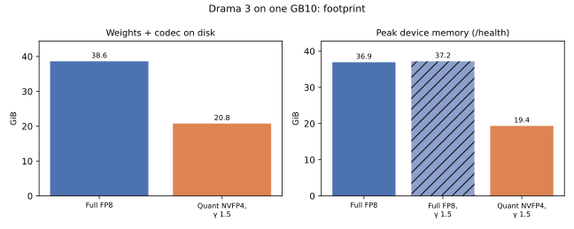
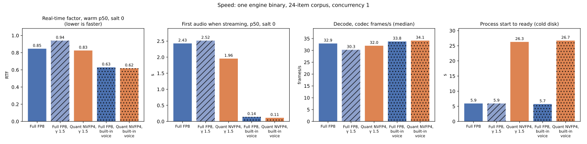
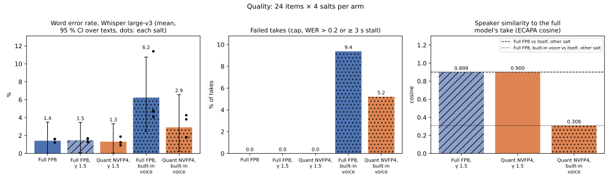

## Full model against this quant

One NVIDIA GB10, one engine binary for every arm, the 24 English texts of the bench corpus (`bench/corpus/drama-bench-en-v1.jsonl`, sha256 `b8995194915f…`) one request at a time, and 4 seed salts (0, 1, 2, 3) per arm. Every number below comes from the files of run `run-01` through `bench/full-vs-quant/report.py`; The Grill's section takes its own from `raw/grill-compare.json`; the per-request records are in `raw/`.

| Arm | Checkpoint | Voice | Engine arguments |
|---|---|---|---|
| Full FP8 | full | reference voice | `serve --context 8192 --parallel 1 --no-drafts --prompt-cache-gib 0 --keep-warm 0 --max-frames 1024` |
| Quant NVFP4, γ 1.5 | quant | reference voice | `serve --context 8192 --parallel 1 --no-drafts --prompt-cache-gib 0 --keep-warm 0 --max-frames 1024 --cfg-gamma 1.5 --cfg-batched` |
| Full FP8, γ 1.5 | full | reference voice | `serve --context 8192 --parallel 1 --no-drafts --prompt-cache-gib 0 --keep-warm 0 --max-frames 1024 --cfg-gamma 1.5 --cfg-batched` |
| Full FP8, built-in voice | full | built-in voice | `serve --context 8192 --parallel 1 --no-drafts --prompt-cache-gib 0 --keep-warm 0 --max-frames 1024` |
| Quant NVFP4, built-in voice | quant | built-in voice | `serve --context 8192 --parallel 1 --no-drafts --prompt-cache-gib 0 --keep-warm 0 --max-frames 1024 --cfg-gamma 1.5 --cfg-batched` |

### The recipe

- **Quant.** NVFP4 routed experts (GPTQ), 7,369 of 10,240 kept. At start-up the engine reports 19.05 GiB of model weights against 36.90 GiB for the full FP8 checkpoint, 7,369 of 10,240 routed experts held and NVFP4 routed experts in 40 of 40 layers. Weights and codec on disk: 20.76 GiB against 38.63 GiB.
- **Engine.** TensorFold native (Zig/CUDA), build `v1.0.11-193-g70dec469` from branch `exp/g6-codec-chunk`, clean tree: yes; binary sha256 `3815f416e351…`. Sampling as the engine reports it: greedy. The quant is served with guidance γ 1.5 (`--cfg-gamma 1.5 --cfg-batched`): a second, unconditioned backbone sequence run in one batch with the first. The full-model arm with the same guidance (FG) separates the effect of guidance from the effect of the quant. With the built-in voice the engine logged γ 1.00 on every reply of QB, so guidance was inactive there. The engine arguments in the table above are complete; none sets a redraw or retry.
- **Codec.** The quant ships Drama 3's codec weights unchanged: `codec.pth` has the same sha256 (`74fc41c5a715…`) in both checkpoints' pins. The engine binary decodes it with codec scratch kept per chunk, a host-side change (the build record is in `tables.json` under `environment.engine_build.change`).

### Results

| Measure | Full FP8 | Quant NVFP4, γ 1.5 | Full FP8, γ 1.5 | Full FP8, built-in voice | Quant NVFP4, built-in voice |
|---|---:|---:|---:|---:|---:|
| Weights + codec on disk (GiB) | 38.63 | 20.76 | 38.63 | 38.63 | 20.76 |
| Peak device memory, /health (GiB) | 36.95 | 19.35 | 37.20 | 36.95 | 19.35 |
| Host MemAvailable drop, max (GiB) | 39.34 | 21.27 | 39.37 | 38.67 | 21.23 |
| Process start to ready, arithmetic median of 4 cold starts (s) | 5.9 | 26.3 | 5.9 | 5.7 | 26.7 |
| Engine load, arithmetic median (s) | 5.7 | 26.1 | 5.8 | 5.6 | 26.5 |
| Real-time factor, warm p50 nearest-rank, salt 0 (all warm passes) | 0.846 | 0.825 | 0.940 | 0.629 | 0.618 |
| Real-time factor, warm p95 nearest-rank, salt 0 (all warm passes) | 1.539 | 1.462 | 1.832 | 0.670 | 0.656 |
| Real-time factor, arithmetic median of each salt's first warm pass, lowest–highest | 0.853–0.866 | 0.824–0.838 | 0.914–0.941 | 0.627–0.640 | 0.611–0.621 |
| Whole reply, warm p50 nearest-rank, salt 0 (s) | 9.53 | 8.38 | 9.30 | 5.33 | 5.37 |
| First audio when streaming, p50 nearest-rank, salt 0 (s) | 2.428 | 1.955 | 2.515 | 0.141 | 0.113 |
| Decode, codec frames/s, streamed, salt 0 (arithmetic median) | 32.9 | 32.0 | 30.3 | 33.8 | 34.1 |
| Prompt tokens per second to first audio (arithmetic median) | 550 | 681 | 530 | 342 | 430 |
| Prompt tokens per request (arithmetic median) | 1335 | 1335 | 1335 | 48 | 48 |
| Warm requests succeeded | 72/72 + 72/72 streamed | 72/72 + 72/72 streamed | 72/72 + 72/72 streamed | 72/72 + 72/72 streamed | 72/72 + 72/72 streamed |
| Word error rate, mean [95 % CI] | 1.42 % [0.00, 3.48] | 1.31 % [0.04, 3.32] | 1.47 % [0.08, 3.46] | 6.23 % [2.45, 10.74] | 2.92 % [0.24, 6.57] |
| Word error rate, pooled | 0.60 % | 0.56 % | 0.71 % | 7.09 % | 1.01 % |
| Word error rate, mean of each salt, lowest–highest | 1.23–1.61 % | 0.91–1.88 % | 1.29–1.69 % | 4.08–11.39 % | 1.80–4.27 % |
| Failed takes (cap, collapsed) | 0/96 (cap 0, collapsed 0) | 0/96 (cap 0, collapsed 0) | 0/96 (cap 0, collapsed 0) | 9/96 (cap 0, collapsed 9) | 5/96 (cap 0, collapsed 5) |
| Failed takes per salt (0 / 1 / 2 / 3) | 0 / 0 / 0 / 0 | 0 / 0 / 0 / 0 | 0 / 0 / 0 / 0 | 2 / 2 / 1 / 4 | 0 / 2 / 2 / 1 |
| Engine finish reason, scored takes | stop 96 | stop 96 | stop 96 | silence 7, stop 89 | silence 2, stop 94 |
| Speaker cosine to the full model's take | 0.901 (itself, other salt) | 0.900 | 0.899 | 0.309 (itself, other salt) | 0.308 |

Two median conventions. Rows marked nearest-rank are the benchmark client's own summaries (`bench/drama_bench.py`, `percentiles`): the sorted value at rank ⌈p·n/100⌉, never interpolated, so a p50 over an even count is the lower of the two middle values. Rows marked arithmetic median are computed by `bench/full-vs-quant/report.py` with Python's `statistics.median`, which averages the two middle values of an even count; the per-salt real-time-factor range is one of these (its `tables.json` key keeps the name `whole_warm_rtf_p50_per_salt`).

| Paired comparison | Pairs | Failed only in first | Failed only in second | Exact McNemar p | WER difference, mean [95 % CI over items] |
|---|---:|---:|---:|---:|---|
| Quant NVFP4, γ 1.5 vs Full FP8 | 96 | 0 | 0 | 1.000 | -0.11 pp [-0.35, +0.08] |
| Full FP8, γ 1.5 vs Full FP8 | 96 | 0 | 0 | 1.000 | +0.05 pp [-0.24, +0.34] |
| Quant NVFP4, γ 1.5 vs Full FP8, γ 1.5 | 96 | 0 | 0 | 1.000 | -0.16 pp [-0.47, +0.00] |
| Quant NVFP4, built-in voice vs Full FP8, built-in voice | 96 | 3 | 7 | 0.344 | -3.31 pp [-7.88, +0.54] |

Real-time factor is client end-to-end time over audio time (lower is faster). Whole warm passes per salt: 3 / 1 / 1 / 1; streamed warm passes ran only in salt(s) 0 (3 per text). Rows marked salt 0 use only that salt. Quality scores only the first warm pass of each salt's whole replies: 24 takes per salt. A take fails if it reaches the 1024-frame cap or collapses (word error rate above 0.2, or a silence of 3 s or more inside the speech). The 95 % intervals resample the 24 texts 10,000 times. Speaker cosine compares ECAPA embeddings with the full model's take of the same text and salt (F for the reference voice, FB for the built-in voice); the cells marked "itself, other salt" are the baseline: the full model's takes of one text at two different salts.

### Charts

In the speed chart the real-time-factor and first-audio bars are the nearest-rank p50 rows of the table; decode and start-to-ready are arithmetic medians.

### Speed under The Grill (separate from run-01)

Measured with The Grill: `grill-perf 0.11.0` (binary sha256 `4491eedb76d9…`, as given to `report.py`), three `media capture` slots and one `media compare` (`media-comparison-v1`, version 1). Slots a and a2 served the configuration of run-01 arm FG (Full FP8, γ 1.5, checkpoint full) and slot b that of arm Q (Quant NVFP4, γ 1.5, checkpoint quant); the comparison pools a and a2 as the reference (A + A2) against b (B). Every reply in the comparison carries `x-cfg-gamma: 1.5` and `content-type: audio/pcm` (streamed). Cells: short-07, medium-01, long-01 from the bench corpus, seed 1, 2 warm-up and 6 measured requests per cell and slot. Capture periods (reply Date headers, UTC): a 2026-10-22 12:22:22–12:26:46; b 2026-10-22 12:28:27–12:32:11; a2 2026-10-22 12:33:45–12:38:11. The comparison is `raw/grill-compare.json` (sha256 `ba79d2c985d8…`), byte for byte; every Grill number in this section comes from it, and every run-01 number from the tables above. The workload file it names has sha256 `b3d2ca680f56…`. This makes no claim about concurrent load.

- **Claim scope**, as the comparison states it: `observed-envelope-direction-under-declared-bounds-not-output-quality`, on the `changed-model` axis, support level `experimental-extension-first-released-v0.9`: The Grill is early experimental software. Reference identity `declared_match`: "Matching declarations do not verify server restoration, cache state, timing order or causal effect."
- **Outcome: INCONCLUSIVE** (reason `changed_model_axis`; exit 2 in the collector's mapping: 0 PASS, 1 ERROR or INVALID, 2 INCONCLUSIVE, 3 REGRESSION). The slots serve different models, which is the point of this comparison; on that axis the collector reports each gate but never an overall pass, so INCONCLUSIVE is the result by design. Captures: acquisition status a complete, b complete, a2 complete; replies a 24, b 24, a2 24, HTTP status 200, 0 failed; measured requests eligible in every cell and slot: all. It is not a failed capture.

| Cell | Gate | Adverse bound | A + A2, min–max | B, min–max | Adverse-bound interval | Outcome |
|---|---|---:|---:|---:|---:|---|
| short-07 | First audio | 5.00 % | 2.478 s–2.505 s (n 12) | 1.890 s–1.900 s (n 6) | -24.5 % to -23.3 % | PASS |
| short-07 | End-to-end | 5.00 % | 5.558 s–5.619 s (n 12) | 4.329 s–4.342 s (n 6) | -23.0 % to -21.9 % | PASS |
| short-07 | Duration ratio | 0.100 | 1.000–1.000 (n 12) | 0.821–0.821 (n 6) | 0.179 | REGRESSION |
| medium-01 | First audio | 5.00 % | 2.514 s–2.528 s (n 12) | 1.914 s–1.923 s (n 6) | -24.3 % to -23.5 % | PASS |
| medium-01 | End-to-end | 5.00 % | 9.135 s–9.189 s (n 12) | 8.404 s–8.414 s (n 6) | -8.5 % to -7.9 % | PASS |
| medium-01 | Duration ratio | 0.100 | 1.000–1.000 (n 12) | 1.015–1.015 (n 6) | 0.015 | PASS |
| long-01 | First audio | 5.00 % | 2.598 s–2.608 s (n 12) | 1.981 s–1.988 s (n 6) | -24.0 % to -23.5 % | PASS |
| long-01 | End-to-end | 5.00 % | 20.795 s–20.895 s (n 12) | 17.411 s–17.421 s (n 6) | -16.7 % to -16.2 % | PASS |
| long-01 | Duration ratio | 0.100 | 1.000–1.000 (n 12) | 0.876–0.876 (n 6) | 0.124 | REGRESSION |

Timing gates: the interval runs from B's minimum against A + A2's maximum to B's maximum against their minimum, as a relative change; negative means B was lower, positive would count against the bound. Duration ratio is B's audio length over A + A2's for the same text and seed; a length change in either direction is adverse, against a bound of 0.100. Every gate's reference-spread limit (`max_reference_spread_bps`) is 20 %; the a and a2 medians are in the next table.

| Cell | First audio, median a / a2 / b (s) | End-to-end, median a / a2 / b (s) | Real-time factor, A + A2 / B (not gated) | B audio length / A + A2 |
|---|---:|---:|---:|---:|
| short-07 | 2.486 / 2.498 / 1.893 | 5.572 / 5.606 / 4.333 | 1.267 / 1.197 | 0.821 |
| medium-01 | 2.524 / 2.524 / 1.918 | 9.157 / 9.187 / 8.410 | 0.963 / 0.871 | 1.015 |
| long-01 | 2.605 / 2.602 / 1.984 | 20.811 / 20.888 / 17.419 | 0.797 / 0.761 | 0.876 |

First audio passes in short-07, medium-01, long-01 and end-to-end time in short-07, medium-01, long-01. Duration ratio is REGRESSION in short-07 and long-01: B's audio is 0.821 and 0.876 of A + A2's length there, an adverse deviation of 0.179 and 0.124 against a bound of 0.100; it passes in medium-01 (1.015). Shorter audio is not a speed-up: end-to-end time grows with the audio produced, so where B's audio is shorter part of its lower end-to-end time is less audio, not faster synthesis. The real-time factor (end-to-end time over audio time, reported by the collector, not gated) is the length-normalised figure: B against A + A2 -5.5 % in short-07, -9.6 % in medium-01, -4.6 % in long-01. B's audio bytes are never equal to A's for the same seed, as expected across a model change; within each slot every cell was deterministic per seed. The finish reason is unknown on 54 measured replies (the engine sends it as an HTTP trailer and the collector reads headers), so the collector cannot flag a clipped reply; the largest body is 2,306,048 bytes, below the 4,194,304 bytes of a 1024-frame reply.

- **What it is not.** It measures its own declared cells and bounds only; it says nothing about output quality (for these two configurations see the Q and FG columns above), and none of its numbers is pooled into run-01's tables or charts.
- **Beside run-01.** For the same two configurations run-01's salt-0 rows point the same way, lower for Q: Q against FG, real-time factor p50 0.825 against 0.940 (-12.2 %), first audio p50 1.955 s against 2.515 s (-22.3 %), whole reply p50 8.38 s against 9.30 s (-9.9 %); Q's warm whole replies at salt 0 hold 910 s of audio against 919 s (-1.0 %). The workloads differ, so the sizes are not interchangeable: run-01 is 24 texts at seed salt 0, whole WAV replies for the real-time factor and whole-reply rows and streamed replies for first audio, with nearest-rank p50s; The Grill is 3 texts at seed 1, streamed PCM replies only, a and a2 pooled, with the collector's medians and min–max ranges.

### How quality was scored

Whisper large-v3 transcribed each take; reference and transcript went through Whisper's English normalizer before a word-level edit distance. Speaker embeddings are SpeechBrain `spkrec-ecapa-voxceleb` at 16 kHz. Transcription ran on: cpu float32.

### Run history

- The run started at 2026-10-22T16:44:41+0800 with harness commit `4a00789`.
- The first pass stopped at Quant NVFP4, γ 1.5 salt 0: the benchmark client refused to start it, finding 40 pinned files missing and 0 mismatched. Missing: 39 under `.cache/huggingface/` and `.gitattributes`; all are hidden paths, which the client does not list. No request was sent.
- Pin change (harness commit `7f14908`): the quant checkpoint's sha256sum list went from 59 to 20 entries. Dropped: 39 under `.cache/huggingface/`; added: 0; every kept entry has the same sha256 as before. The resumed preflight verified the quant checkpoint's 20 files (exit 0). The benchmark client got the same list less hidden paths: 19 entries (`.gitattributes` left out), all with the same sha256.
- The run resumed at 2026-10-22T17:37:25+0800. Against the first preflight: binary same, voice same, corpus same, arms same, salts same. Arms measured entirely before the resume, and kept: Full FP8. The set-aside directory (`Q/resume-1-aside-s0`) is in no number here.
